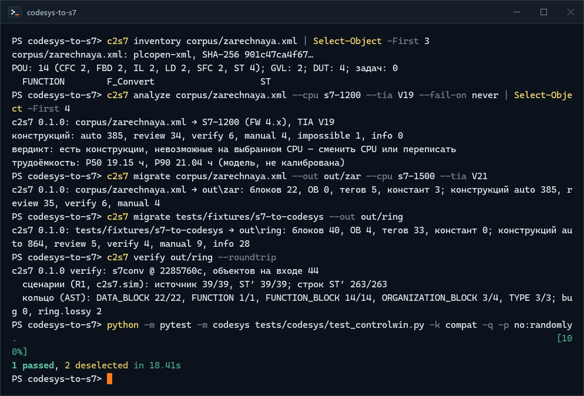
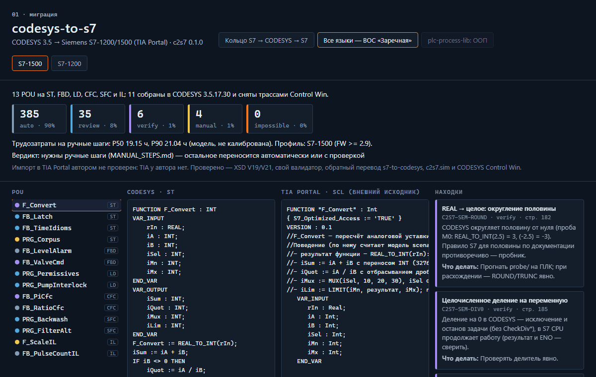
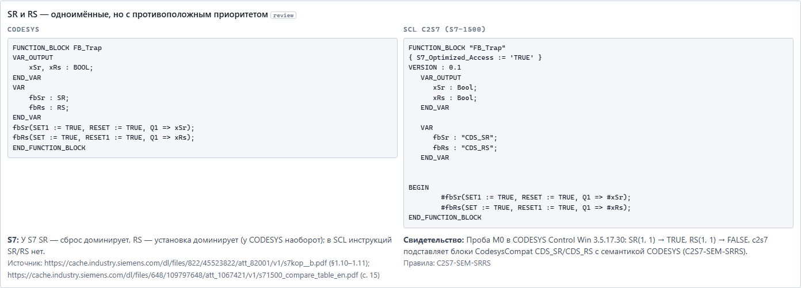
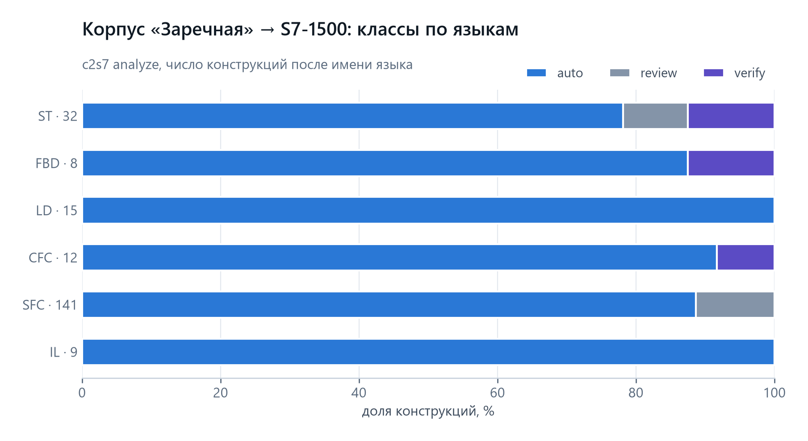
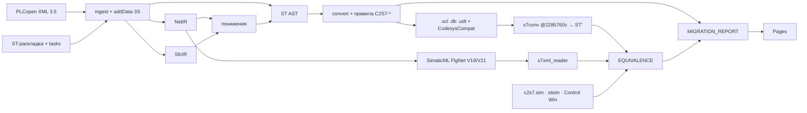

<p align="center">
  <picture>
    <source media="(prefers-color-scheme: dark)" srcset="docs/media/banner-dark.svg">
    <source media="(prefers-color-scheme: light)" srcset="docs/media/banner-light.svg">
    
  </picture>
</p>

<p align="center">
  <a href="https://github.com/kr0nsch/codesys-to-s7/actions/workflows/ci.yml"></a>
  <a href="LICENSE"></a>
  <a href="https://kr0nsch.github.io/codesys-to-s7/"></a>
  
  
  
</p>

<p align="center">
  <a href="#демонстрация">Демо</a> ·
  <a href="#архитектура">Архитектура</a> ·
  <a href="#быстрый-старт">Быстрый старт</a> ·
  <a href="docs/">Документация</a> ·
  <a href="#summary-en">Summary (EN)</a>
</p>

**codesys-to-s7** (`c2s7`) переносит проект CODESYS 3.5 — тот, что крутится в ОВЕН ПЛК210 или
REGUL, — в Siemens S7-1200/1500 под TIA Portal. На входе PLCopen XML или ST-раскладка, на выходе то,
что TIA принимает документированными путями: внешние исходники `.scl/.db/.udt`, сети LAD/FBD в
SimaticML, таблица тегов `.xlsx`, тела OB с планом задач и отчёт, где у каждой конструкции есть класс:
перенеслась без потерь, нужна проверка, нужна проба на ПЛК, вручную или невозможна на этом CPU.

**Зачем.** Siemens и CODESYS часто стоят на одном объекте, и одну логику ведут в двух диалектах
вручную. Молчаливые ловушки между ними — SR/RS с противоположным приоритетом, `%IW5` ≠ `%IW5`,
TIME без знака, самосбрасывающийся таймер — c2s7 не прячет, а называет правилом с источником.

**Для кого.** Инженер АСУ ТП, который переходит между OWEN/REGUL (CODESYS) и Siemens: оценить объём
ручной работы, получить заготовку проекта TIA и понять, где поведение может разойтись.

**Как проверено.** Обратным ходом через [s7-to-codesys](https://github.com/kr0nsch/s7-to-codesys):
SCL → ST′ → сравнение с исходником и прогон сценариев в своём интерпретаторе и в CODESYS Control Win.
Импорт в TIA Portal автором не проверен — TIA у автора нет; процедура для человека с TIA —
[HARDWARE_VALIDATION.md](docs/HARDWARE_VALIDATION.md).

## Демонстрация

<p align="center">
  
</p>
<p align="center"><sub>Реальный прогон: c2s7 0.1.0, CODESYS 3.5.17.30 Control Win, снято term2gif.py, паузы сокращены</sub></p>

<p align="center">
  
</p>
<p align="center"><sub>Просмотрщик <a href="https://kr0nsch.github.io/codesys-to-s7/">kr0nsch.github.io/codesys-to-s7</a> (Playwright); схемы цели построены c2s7, это не снимки TIA</sub></p>

<p align="center">
  <picture>
    <source media="(prefers-color-scheme: dark)" srcset="docs/media/shot-trap-srrs-dark.png">
    
  </picture>
</p>

## Кольцо S7 → CODESYS → S7

Корпус s7-to-codesys @ `2285760c` (20 файлов SCL, 44 блока) прошёл S7 → CODESYS у s7-to-codesys и
CODESYS → S7 у c2s7. Результат сверен с исходным SCL по нормализованному AST и по поведению.

| Проверка | Итог |
|---|---|
| AST: FB / FC / TYPE / DB / OB | 14/14 · 1/1 · 3/3 · 22/22 · 3/4 |
| расхождения | bug 0, ring.lossy 2 — аргументы Variant/Any, которые s7conv не переносит ([CASES.md](docs/CASES.md)) |
| сценарии R1 в своём интерпретаторе (источник и ST′) | 39/39, 263 строки |
| stsim s7-to-codesys (второе мнение) | 39/39 |
| CODESYS Control Win: coUnit из сценариев (R1) | 39/39 |
| CODESYS Control Win: трассы цикла 10 мс (R2), источник и ST′ | 50 739 циклов, без расхождений |

Кольцо доказывает согласованность c2s7 и s7conv (один автор), а не компиляцию в TIA: общие ошибки
могут погаситься. Противовесы — эталонные модели сценариев, Control Win как эталон поведения, XSD.

## Что переносится автоматически

Корпус «все языки» — вымышленная фильтровальная станция ВОС «Заречная», 13 POU на шести языках;
11 собраны в CODESYS 3.5.17.30 и сняты трассами (IL CODESYS из PLCopen не импортирует).

<p align="center">
  <picture>
    <source media="(prefers-color-scheme: dark)" srcset="docs/media/chart-classes-dark.png">
    
  </picture>
</p>

| Язык CODESYS | Цель | Как |
|---|---|---|
| ST | SCL | свой парсер, явные преобразования типов, `CTU_UINT`/`TON_TIME`, ключевые слова SCL, AT → теги |
| LD | LAD (SimaticML FlgNet) или SCL | контакты НО/НЗ, P/N (бит памяти в статике), катушки, S/R, параллели; вне подмножества — блок в SCL |
| FBD | FBD (FlgNet) или SCL | логика, сравнения, арифметика, MOVE, TON/TOF/TP, Jump/Label |
| CFC | SCL | порядок `executionOrderId`, обратные связи — статика со значением прошлого цикла |
| SFC | автомат SCL | порядок цикла CODESYS: IEC-действия N/S/R/P с последним вызовом, время шага, альтернативы, параллели |
| IL | SCL через ST | текущий результат, скобки, JMPC назад → REPEAT, CAL |
| GVL, DUT, задачи | DB, UDT, теги, константы, план OB | приоритеты задач → приоритеты OB, OB создаёт человек по `TASKS.md` |

Корпус целиком (S7-1500): auto 385, review 35, verify 6, manual 4, impossible 0. R1 — 29/29
сценариев для источника и выхода на обоих CPU; R2 — 2227/2227 циклов трасс Control Win.

## S7-1200 или S7-1500

Профиль выбирается `--cpu s7-1200|s7-1500` и `--tia V19|V21`. Различия, которые c2s7 учитывает:
GRAPH, CFC и STL только на 1500 (на 1200 — находка impossible и автомат SCL), LTime и `REF_TO` только
на 1500 (литерал TIME больше 24 суток на 1200 — impossible), лимит cyclic interrupt OB на 1200 (4),
SimaticML FlgNet — только для V19/V21 (для остальных версий — SCL). S7-1200 G2 не поддерживается.

## Архитектура



Подробно — [ARCHITECTURE.md](docs/ARCHITECTURE.md).

## Быстрый старт

Без ПЛК, TIA и CODESYS — нужен только Python 3.12:

```bash
git clone https://github.com/kr0nsch/codesys-to-s7.git && cd codesys-to-s7
python -m venv .venv && .venv/Scripts/activate        # Linux: source .venv/bin/activate
pip install -r requirements-dev.txt -e .

c2s7 inventory corpus/zarechnaya.xml                   # состав: POU по языкам, GVL, DUT, задачи
c2s7 analyze corpus/zarechnaya.xml --cpu s7-1200 --tia V19
c2s7 migrate corpus/zarechnaya.xml --out out/zar --cpu s7-1500 --tia V21 --zip out/zar.zip
c2s7 explain C2S7-SEM-SRRS                             # описание правила с источником
c2s7 site --out site-out                               # просмотрщик локально
```

Кольцо через s7-to-codesys (нужен его клон на закреплённом коммите):

```bash
git clone https://github.com/kr0nsch/s7-to-codesys.git .cache/s7-to-codesys@2285760c
git -C .cache/s7-to-codesys@2285760c checkout 2285760c1c99ce4218d5356c75e93111828f8e3b
c2s7 migrate tests/fixtures/s7-to-codesys --out out/ring
c2s7 verify out/ring --roundtrip --oracle stsim
```

## Как использовать в своём проекте

1. **Выгрузите проект из CODESYS:** Project → Export PLCopenXML (POU, GVL, DUT; для задач —
   Application целиком). Если каналы ввода-вывода привязаны в дереве устройств (у ОВЕН так), выгрузите
   и их: устройство → Export mappings to CSV.
2. **Оцените:** `c2s7 analyze project.xml --cpu s7-1500 --tia V21 --io-map io.csv --format html > analyze.html`.
   Классы и часы (модель, не калибрована) покажут, сколько ручной работы. `--fail-on manual` даёт код 1
   для CI.
3. **Перенесите:** `c2s7 migrate project.xml --out out/project --cpu s7-1500 --tia V21 --io-map io.csv`.
4. **Импортируйте в TIA** (порядок — `roundtrip/MANUAL_STEPS.md`): External source files →
   `tia/compat/`, затем `tia/sources/` по номерам → Generate blocks from source; теги —
   `tia/tags/PLCTags.xlsx`; LAD/FBD — `tia/simaticml/*.xml` через Openness; OB — по `roundtrip/TASKS.md`
   с телами из `tia/ob/`.
5. **Проверьте спорное:** находки verify собраны в `probe/` — минимальные блоки SCL с ожидаемыми
   значениями по CODESYS; результаты PLCSIM записываются в `probe/RESULTS.csv`.

Если исходник — ST-раскладка (как у [plc-repo-template](https://github.com/kr0nsch/plc-repo-template)),
подайте каталог вместо XML: задачи берутся из `tasks.json` или `tools/codesys/config.json`.

## Тесты и проверки

```bash
python -m ruff check . && python -m mypy                 # mypy --strict
python -m pytest                                         # 272 теста; с клоном s7-to-codesys — кольцо
python -m pytest -m codesys tests/codesys                # локально, нужен CODESYS 3.5.17.30
```

- 57 правил C2S7-*, у каждого — корпус pos/neg, описание и источник ([RULES.md](docs/RULES.md));
  таблицы соответствия — [MAPPING.md](docs/MAPPING.md).
- SimaticML: свой валидатор (10 правил с негативами), XSD V19/V21 в CI, golden-файлы, обратное чтение.
- Свойства (hypothesis, 300 примеров): свёртка переходов, таблицы истинности LD через FlgNet, автомат SFC.
- Покрытие: строки 90 %, ветви 80 %. CI — ubuntu и windows, XSD, RuSTy, побайтный детерминизм zip.
- Итоги прогонов — [TEST_REPORT.md](docs/TEST_REPORT.md), оракулы — [ORACLES.md](docs/ORACLES.md).

## Документация

[ARCHITECTURE](docs/ARCHITECTURE.md) · [CASES](docs/CASES.md) · [EQUIVALENCE](docs/EQUIVALENCE.md) ·
[FORMAT-CODESYS](docs/FORMAT-CODESYS.md) · [FORMAT-TIA](docs/FORMAT-TIA.md) · [PROBES](docs/PROBES.md) ·
[ASSUMPTIONS](docs/ASSUMPTIONS.md) · [SOURCES](docs/SOURCES.md) · [HARDWARE_VALIDATION](docs/HARDWARE_VALIDATION.md) ·
[ROADMAP](docs/ROADMAP.md) · [CHANGELOG](CHANGELOG.md) · [CONTRIBUTING](CONTRIBUTING.md)

## Чего инструмент не делает

- Не создаёт проект TIA и аппаратную конфигурацию, не переназначает каналы ввода-вывода.
- Не переносит связь и HMI: Modbus, OPC UA, Symbol Configuration → находка C2S7-LIB (MB_SERVER/OPC UA S7 — вручную).
- Импорт в TIA Portal автором не проверен; SimaticML соответствует XSD V19/V21 и структуре эталонного
  набора (его происхождение [M]) — это не подтверждение формата.
- ООП (METHOD, PROPERTY, EXTENDS) и указатели — план в `MANUAL_STEPS.md`, перенос вручную.
- В 0.1.0 нет GRAPH, SD, CFC → FBD, квалификаторов SFC L/D/SD/DS/SL и CodesysCompat кроме CDS_SR/RS
  ([ROADMAP.md](docs/ROADMAP.md)).
- IL и боксы EN/ENO CODESYS 3.5.17 из PLCopen не импортирует (проба M0) — IL проверен только в своём
  интерпретаторе.

## Summary (EN)

**codesys-to-s7** (`c2s7`) migrates CODESYS 3.5 projects (OWEN, REGUL and other CODESYS PLCs) to
Siemens S7-1200/1500 for TIA Portal. Input: PLCopen XML or an ST source layout. Output: external
sources `.scl/.db/.udt`, LAD/FBD networks as SimaticML FlgNet (V19/V21, closed subset, own validator
plus XSD), a PLC tag table `.xlsx`, OB bodies with a task plan, and a migration report that classifies
every construct as auto / review / verify / manual / impossible.

<details>
<summary>In English: what is verified and how</summary>

- **Round trip S7 → CODESYS → S7** through [s7-to-codesys](https://github.com/kr0nsch/s7-to-codesys)
  @ `2285760c`: AST matches FB 14/14, FC 1/1, TYPE 3/3, DB 22/22, OB 3/4 (two known losses of
  Variant/Any arguments in s7conv), 0 bugs; 39/39 scenarios in the own CODESYS-semantics interpreter,
  in stsim and as coUnit tests in CODESYS Control Win 3.5.17.30; cycle traces (10 ms) of source and
  ST′ replayed without divergence.
- **All-languages corpus** (13 POUs in ST, FBD, LD, CFC, SFC, IL; fictional water filtration plant):
  11 POUs built in CODESYS, exports semantically equal to the DSL spec, 29/29 scenarios for source and
  output on both CPUs, 2227/2227 Control Win trace cycles.
- **Not verified:** import into TIA Portal (the author has no TIA). A procedure for an engineer with
  TIA and PLCSIM, plus a probe set with expected CODESYS values, ships in the repo.
- Live viewer: <https://kr0nsch.github.io/codesys-to-s7/>. Docs are in Russian.

</details>

## Лицензия

MIT — [LICENSE](LICENSE). Корпус s7-to-codesys и `tools/codesys/` из plc-repo-template — MIT,
с атрибуцией. Документы и XSD Siemens в репозиторий не входят (только ссылки и загрузка по SHA-256).

Проект не связан с компаниями ОВЕН, Прософт-Системы, РегЛаб, Siemens AG и CODESYS GmbH; названия
продуктов — товарные знаки их владельцев.

---

<p align="center"><b>Портфолио АСУ ТП</b></p>
<table>
<tr><td width="33%"><a href="https://github.com/kr0nsch/plc-repo-template">01 · plc-repo-template</a><br><sub>ST в git, сборка проекта скриптом, CI</sub></td><td width="33%"><a href="https://github.com/kr0nsch/plc-process-lib">02 · plc-process-lib</a><br><sub>ФБ: AI, двигатель, ПЧ, задвижка, ПИД, тревоги</sub></td><td width="33%"><a href="https://github.com/kr0nsch/kns-pump-station">03 · kns-pump-station</a><br><sub>флагман: КНС, три насоса с ПЧ, модель, ПМИ</sub></td></tr>
<tr><td width="33%"><a href="https://github.com/kr0nsch/kns-port-domestic">04 · kns-port-domestic</a><br><sub>перенос на Astra.IDE / MasterSCADA 4D</sub></td><td width="33%"><a href="https://github.com/kr0nsch/plc-iiot-stack">05 · plc-iiot-stack</a><br><sub>OPC UA / MQTT → InfluxDB → Grafana</sub></td><td width="33%"><a href="https://github.com/kr0nsch/iolistgen">06 · iolistgen</a><br><sub>перечень сигналов → ST, карты Modbus, SCADA</sub></td></tr>
<tr><td width="33%"><a href="https://github.com/kr0nsch/plc-ci-toolkit">07 · plc-ci-toolkit</a><br><sub>линтеры, сборка CODESYS, тесты, JUnit</sub></td><td width="33%"><a href="https://github.com/kr0nsch/s7-to-codesys">08 · s7-to-codesys</a><br><sub>конвертер SCL → ST с отчётом о переносе</sub></td><td width="33%"><a href="https://github.com/kr0nsch/sis-interlock-demo">09 · sis-interlock-demo</a><br><sub>ПАЗ: MooN, матрица причин и следствий</sub></td></tr>
<tr><td width="33%"><a href="https://github.com/kr0nsch/codesys-to-s7"><b>codesys-to-s7</b></a><br><sub>CODESYS → Siemens S7: SCL, SimaticML, кольцо</sub></td></tr>
</table>

<p align="center"><b>Миграция ПЛК-проектов</b></p>
<table>
<tr><td width="33%"><a href="https://github.com/kr0nsch/codesys-to-s7"><b>01 · codesys-to-s7</b></a><br><sub>CODESYS → Siemens S7: SCL, SimaticML, round-trip</sub></td><td width="33%"><span data-repo="codesys-to-astra">02 · codesys-to-astra</span> <sub>(готовится)</sub><br><sub>CODESYS → REGUL/Astra.IDE: библиотеки, ввод-вывод</sub></td><td width="33%"><span data-repo="codesys-to-polygon">03 · codesys-to-polygon</span> <sub>(готовится)</sub><br><sub>CODESYS → «Полигон»: анализ и перенос в FBD</sub></td></tr>
<tr><td width="33%"><span data-repo="codesys-to-masterscada">04 · codesys-to-masterscada</span> <sub>(готовится)</sub><br><sub>CODESYS → MasterSCADA 4D: логика и объекты</sub></td><td width="33%"><span data-repo="codesys-to-forgelogic">05 · codesys-to-forgelogic</span> <sub>(готовится)</sub><br><sub>CODESYS → МЭК 61499: ФБ, события, 4diac</sub></td></tr>
</table>
<p align="center"><sub>Обратное направление — <a href="https://github.com/kr0nsch/s7-to-codesys">s7-to-codesys</a> (Siemens S7 → CODESYS); перенос в ALTA IDE — <span data-repo="alta-port">alta-port</span> <sub>(готовится)</sub>.</sub></p>
