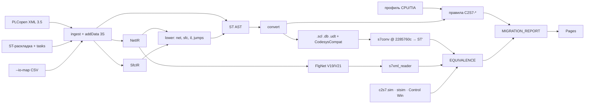

# Архитектура c2s7

| Пакет | Что делает |
|---|---|
| `c2s7.ingest` | PLCopen XML CODESYS (три размещения addData 3S, CFC в addData, методы/свойства, задачи), ST-раскладка plc-repo-template (`tasks.json`, `tools/codesys/config.json`), одиночный `.st`, `--io-map` |
| `c2s7.st` | своя грамматика ST на lark (LALR, позиции), AST, разбор литералов, таблица элементарных типов. Парсер s7conv не используется (ADR-2) |
| `c2s7.ir` | NetIR (сети LD/FBD/CFC), SfcIR (шаги, переходы, действия) |
| `c2s7.lower` | IL → ST (текущий результат символьно), сети → ST (поток питания, фронты в статике, CFC по `executionOrderId` с обратными связями в статике), SFC → автомат в порядке цикла CODESYS, `jumps.py` — свёртка переходов в IF/REPEAT |
| `c2s7.convert` | ST AST → блоки S7: типы, секции, DB, теги и адреса, константы, план OB и приоритеты, распознавание S7Compat в кольце, правила C2S7-* |
| `c2s7.rules` | реестр правил (YAML), сборщик находок, модель трудозатрат (треугольное распределение, Монте-Карло, seed 20261019) |
| `c2s7.emit` | внешние исходники TIA (UTF-8 BOM, CRLF), теги `.xlsx`, файлы кольца, отчёты, SimaticML FlgNet + валидатор + проверка XSD, пробник `probe/` |
| `c2s7.sim` | интерпретатор ST с семантикой CODESYS (проба M0), сценарии R1/R2 |
| `c2s7.verify` | клон s7conv по SHA, обратный перевод, нормализованное сравнение AST, stsim, чтение SimaticML |
| `c2s7.render`, `c2s7.site` | SVG схем источника и цели, статический просмотрщик для Pages |

ADR (кратко):

1. Python — как s7-to-codesys и скрипты CODESYS.
2. Свой фронтенд ST, иначе кольцо проверяло бы парсер s7conv им же.
3. ST AST — центр: любой язык гарантированно выводится в SCL; NetIR сохраняет графику там, где цель
   её поддерживает (FlgNet на закрытом подмножестве).
4. Только документированные пути импорта TIA (внешние исходники, SimaticML через Openness), без
   декомпиляции и сниппетов Siemens.
5. Умолчания: `--graphics simaticml` только при `--tia V19|V21`, `--sfc scl`, таймеры и фронты TIA.
6. Детерминизм: UId по обходу, фиксированные метки, одинаковые байты двух прогонов (zip, отчёт).
7. Свой оракул `c2s7.sim` в CI; эталон поведения — CODESYS Control Win.

Инструменты вне пакета: `tools/codesys/` (копия plc-repo-template @ `da0fc917` + свои скрипты
пробы, трасс и проверок), `tools/corpus/` (DSL корпуса, сборка в CODESYS, сценарии), `tools/probes/`
(проба M0), `tools/fetch_xsd.py`, `tools/make_data.py`, `tools/e2e_smoke.py`, `tools/make_media.py`.
